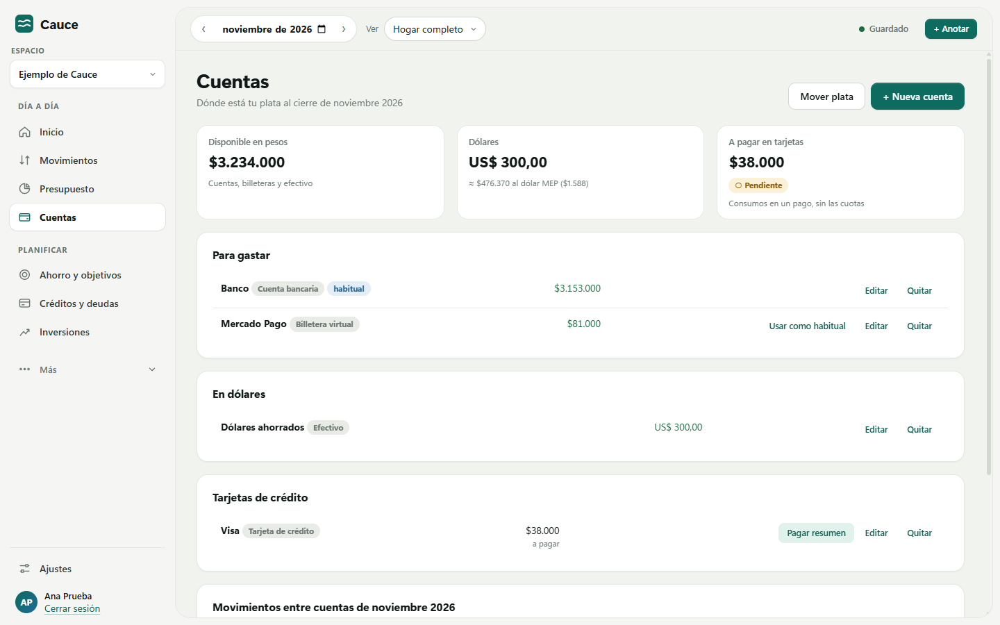
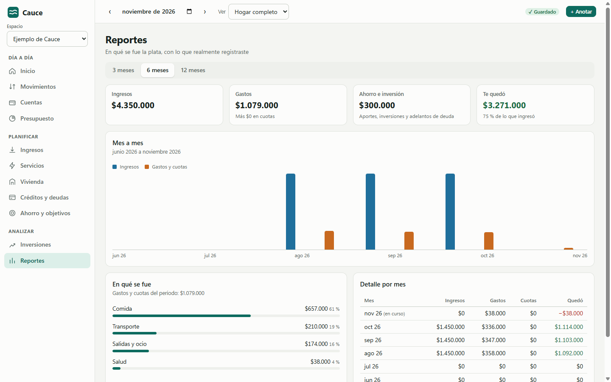
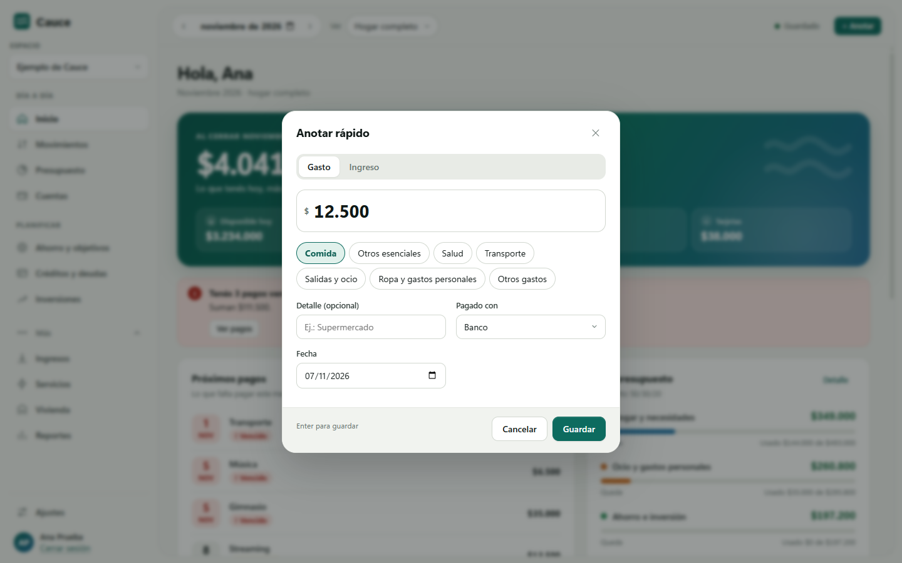
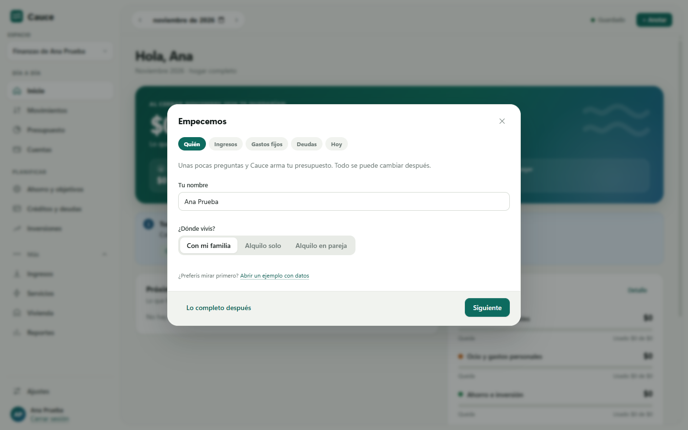
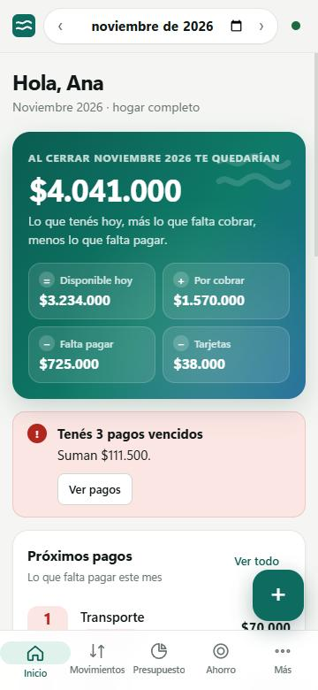
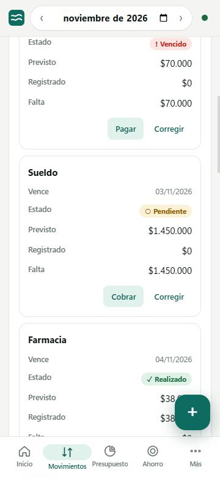
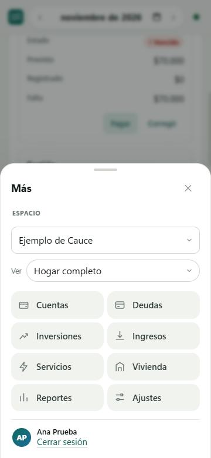
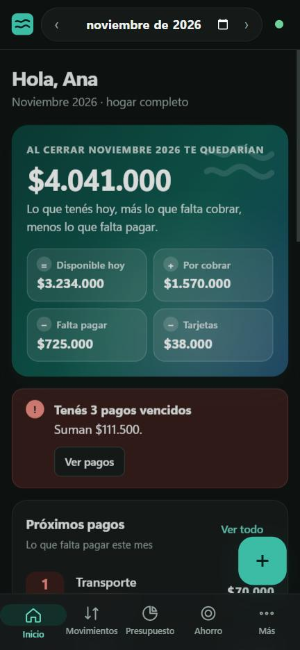

  

<h1 align="center">Cauce</h1>

  <strong>Tu dinero, con un rumbo claro.</strong> 
  Finanzas personales y del hogar para Windows y Android: presupuesto, cuentas, deudas, inversiones y objetivos, en pesos argentinos.

  
  
  
  
  
  

  <a href="https://github.com/th-arroyo/cauce-releases/releases/latest"><strong>Descargar para Windows</strong></a>
  ·
  <a href="https://github.com/th-arroyo/cauce-releases/releases/latest"><strong>Descargar para Android</strong></a>
  ·
  <a href="#cauce-10">Novedades</a>
  ·
  <a href="#instalación">Cómo instalar</a>
  ·
  <a href="#tus-datos">Privacidad</a>

  <picture>
    <source media="(prefers-color-scheme: dark)" srcset="assets/inicio-oscuro.png">
    
  </picture>

## Qué hace

Cauce convierte tus ingresos, gastos, deudas e inversiones en un presupuesto y un plan de acción concretos. Sirve para una persona, una pareja o una familia.

**Día a día**

| Función | Qué te permite |
|---|---|
| **Anotar rápido** | Cargar un gasto en segundos con el botón **+ Anotar** o `Ctrl + N`: importe, categoría y listo. |
| **Cuentas y billeteras** | Ver cuánto tenés en el banco, en Mercado Pago, en efectivo y en dólares. «Disponible hoy» coincide con la realidad. |
| **Tarjetas de crédito** | Lo comprado en un pago cuenta como gasto del mes y sale del banco recién cuando pagás el resumen, sin contarse dos veces. |
| **Presupuesto 50/30/20** | Porcentajes configurables. Cada total se puede abrir para ver de dónde sale. |
| **Recordatorios** | Avisos de Windows antes de que venza un servicio, una cuota o un gasto previsto. |

**Planificar**

| Función | Qué te permite |
|---|---|
| **Ingresos y servicios** | Lo previsto y lo pagado en una sola obligación, con aumentos automáticos por inflación o paritarias. |
| **Vivienda y mudanza** | Vivir con familiares, alquilar solo o en pareja, ajustes de alquiler por índice y escenarios de mudanza sin tocar tus datos reales. |
| **Créditos y deudas** | Calendario real de cada préstamo y compra en cuotas, capacidad conservadora para nuevas cuotas y un plan mes a mes para cancelar antes. |
| **Ahorro y objetivos** | Fondo de emergencia con meta automática según tus gastos esenciales, y metas propias con recomendaciones que respetan tu presupuesto. |

**Analizar**

| Función | Qué te permite |
|---|---|
| **Reportes** | En qué se fue la plata por categoría, ingresos contra gastos mes a mes y cuánto te quedó. |
| **Inversiones** | CEDEARs y acciones con cotizaciones actualizadas, precio promedio, resultado y tiempo de tenencia. |

**A tu gusto:** tema claro u oscuro, o que siga a Windows.

**En pareja o en familia:** compartí un espacio con permiso de lectura o de edición. Si los dos cargan cosas al mismo tiempo, Cauce las combina solo.

## Cauce 1.0

**La primera versión pública.** Todo lo que Cauce hace, en Windows y en Android, con tus datos en tu propio Google Drive.

- **Bienvenida y recorrido guiado.** La primera vez que abrís Cauce te explica los conceptos básicos y te muestra cada sección, señalando dónde está en el menú. Lo podés volver a ver cuando quieras desde **Ajustes › Cuenta y apariencia**.
- **Deudas y cuotas al día.** Cada compra en cuotas aparece en su mes y desaparece sola cuando terminás de pagarla. El saldo incluye la cuota del mes hasta que la registrás, y lo que pagás de más no adelanta cuotas sin que lo elijas.
- **Compras en cuotas desde «Anotar».** Tarjeta, préstamo o compra en cuotas, cuántas cuotas y desde qué mes.
- **Avisos por servicio**, pagos con monto final y metas de ahorro sin un número fijo.
- **Recomendar Cauce y Sugerencias y errores**, desde el menú, para compartir la app o proponer mejoras.

El detalle de cada versión está en [Releases](https://github.com/th-arroyo/cauce-releases/releases).

## Capturas

<table>
  <tr>
    <td width="50%">
      <picture>
        <source media="(prefers-color-scheme: dark)" srcset="assets/cuentas-oscuro.png">
        
      </picture>
      
<b>Cuentas</b>: dónde está tu plata, en pesos y en dólares.

    </td>
    <td width="50%">
      <picture>
        <source media="(prefers-color-scheme: dark)" srcset="assets/reportes-oscuro.png">
        
      </picture>
      
<b>Reportes</b>: en qué se fue la plata, mes a mes.

    </td>
  </tr>
  <tr>
    <td width="50%">
      <picture>
        <source media="(prefers-color-scheme: dark)" srcset="assets/presupuesto-oscuro.png">
        
      </picture>
      
<b>Presupuesto</b>: cuánto te queda en cada parte del 50/30/20.

    </td>
    <td width="50%">
      <picture>
        <source media="(prefers-color-scheme: dark)" srcset="assets/anotar-oscuro.png">
        
      </picture>
      
<b>Anotar rápido</b>: un gasto en segundos.

    </td>
  </tr>
  <tr>
    <td width="50%">
      <picture>
        <source media="(prefers-color-scheme: dark)" srcset="assets/deudas-oscuro.png">
        
      </picture>
      
<b>Plan para cancelar</b>: cuánto adelantar, a qué y cuándo terminás.

    </td>
    <td width="50%">
      <picture>
        <source media="(prefers-color-scheme: dark)" srcset="assets/inversiones-oscuro.png">
        
      </picture>
      
<b>Inversiones</b>: cotización, fuente, resultado y tenencia.

    </td>
  </tr>
  <tr>
    <td width="50%">
      <picture>
        <source media="(prefers-color-scheme: dark)" srcset="assets/guia-oscuro.png">
        
      </picture>
      
<b>Guía inicial</b>: cinco preguntas y tu presupuesto queda armado.

    </td>
    <td width="50%">
      <picture>
        <source media="(prefers-color-scheme: dark)" srcset="assets/ingreso-oscuro.png">
        
      </picture>
      
<b>Ingreso</b>: con tu cuenta de Google, sin contraseñas nuevas.

    </td>
  </tr>
</table>

**En el celular**

  
  &nbsp;
  
  &nbsp;
  
  &nbsp;
  

Las capturas usan datos de ejemplo.

## Instalación

### Windows

1. Descargá **`Cauce-Setup-<versión>.exe`** desde la [última versión](https://github.com/th-arroyo/cauce-releases/releases/latest).
2. Abrilo. Si Windows muestra **«Windows protegió tu PC»**, tocá **Más información** y después **Ejecutar de todos modos**. Aparece porque el instalador no tiene una firma comercial.
3. Cauce se instala solo para tu usuario, sin pedir permisos de administrador, y crea accesos directos en el escritorio y en el menú Inicio.
4. Tocá **Ingresar con Google**. La primera vez, Cauce te da la bienvenida con un recorrido por cada sección y una guía de cinco preguntas para armar tu presupuesto.

**Requisitos:** Windows 10 u 11 de 64 bits y una cuenta de Google. Hace falta internet para el primer ingreso; después la app funciona también sin conexión.

### Android

1. Desde el celular, abrí la [última versión](https://github.com/th-arroyo/cauce-releases/releases/latest) y descargá **`Cauce-<versión>.apk`**.
2. Abrí el archivo. Android te pide permitir instalar apps desde esa fuente (el navegador o la app de archivos): activalo y volvé.
3. Tocá **Instalar**. Si Google Play Protect avisa que no conoce la app, elegí **Instalar de todas formas**: pasa con las apps que no vienen de la Play Store.
4. Abrí Cauce y tocá **Ingresar con Google**. Se usa la cuenta de Google del teléfono, sin contraseñas nuevas. La primera vez te muestra un recorrido por cada sección.

**Requisitos:** Android 7 o posterior con los servicios de Google, y una cuenta de Google.

Un espacio que te compartieron se abre una vez desde Cauce en la PC (**Ajustes › Acceso › Elegir en Google Drive**); después aparece solo en el celular.

## Actualizaciones

Cada vez que abrís Cauce, la app busca una versión nueva. Si la hay, te muestra las novedades y **te pregunta antes de descargar e instalar**. Si elegís «Más tarde», seguís usando tu versión y vuelve a preguntar la próxima vez. Tus datos no se modifican al actualizar. La primera vez que abrís la versión nueva, Cauce te muestra sus novedades en una ventana.

En Android, la app descarga la versión nueva desde esta página, comprueba que el archivo sea el publicado y abre el instalador del teléfono: un toque en **Actualizar** y listo. La primera vez, Android pide permitir que Cauce instale actualizaciones. **Si usabas una versión de prueba (1.1 a 1.5):** Cauce empezó a numerar de nuevo desde la 1.0, así que esa versión no te va a ofrecer la 1.0 sola. Instalala una vez a mano, encima de la que tenés, en Windows y en Android: no se pierde nada y desde ahí las actualizaciones vuelven a llegar solas.

## Ideas y errores

¿Se te ocurre algo que le falta a Cauce o encontraste un error? Desde la app, en **Sugerencias y errores**, se abre un formulario ya armado. También podés escribir directamente en [Issues](https://github.com/th-arroyo/cauce-releases/issues). Necesitás una cuenta gratuita de GitHub y lo que escribas es público: no pongas datos personales ni importes.

## Tus datos

- **En tu Google Drive.** Cada espacio es un archivo dentro de la carpeta «Cauce» de tu Drive, con una copia en tu computadora o tu celular para usar la app sin internet. En el celular esa copia vive en la carpeta privada de la app, que otras apps no pueden leer.
- **Acceso mínimo.** Cauce solo puede abrir los archivos que crea o que elegís; no ve el resto de tu Drive.
- **Sin servidores propios.** No hay una base de datos de Cauce: nadie más recibe tu información.
- **Sin publicidad ni seguimiento.** La app no tiene publicidad ni herramientas de análisis, y no vende datos.
- **Cotizaciones.** Para actualizar precios solo se consultan los símbolos de tus inversiones, como «NVDA», y el valor del dólar, a Data912, DolarApi y Yahoo Finance.

Para borrar todo: eliminá la carpeta «Cauce» de tu Drive, cerrá sesión en la app, borrá `%APPDATA%\Cauce` y quitá el permiso en [tu cuenta de Google](https://myaccount.google.com/permissions).

## Preguntas frecuentes

<b>¿Puedo usar Cauce sin internet?</b>

 
Sí. Todo se guarda primero en tu computadora y se sincroniza con Drive cuando vuelve la conexión.

<b>¿Qué pasa si mi pareja y yo cargamos cosas al mismo tiempo?</b>

 
Cauce combina solos los cambios distintos, por ejemplo dos gastos diferentes. Solo pregunta qué conservar cuando los dos cambiaron exactamente el mismo dato, y lo que no elijas queda en el historial de Drive.

<b>¿Cómo comparto mis finanzas con mi pareja?</b>

 
En <b>Ajustes › Acceso</b>, escribí su correo y elegí si puede solo leer o también editar. La otra persona abre el espacio desde <b>Elegir en Google Drive</b>. Podés cambiar o quitar el permiso en cualquier momento.

<b>¿Cómo registro una compra con tarjeta?</b>

 
Si es en un pago, anotala eligiendo la tarjeta en «Pagado con»: cuenta como gasto del mes y, cuando pagues el resumen desde <b>Cuentas › Pagar resumen</b>, sale del banco sin contarse de nuevo. Si es en cuotas, cargala como compra en <b>Créditos y deudas</b>.

<b>¿Por qué Google me pide volver a ingresar cada tanto?</b>

 
Pasa si cambiaste la contraseña de Google, si quitaste el permiso de Cauce o si pasó mucho tiempo sin usar la app. Volvés a tocar «Ingresar con Google» y seguís donde estabas; no se pierde nada.

<b>¿Cómo elimino un espacio o empiezo de cero?</b>

 
En <b>Ajustes › Datos y respaldo › Eliminar este espacio</b>. Para confirmar hay que escribir su nombre. El archivo va a la papelera de tu Google Drive, desde donde lo podés recuperar por un tiempo. Si era tu único espacio, se crea uno nuevo vacío con la guía «Empecemos».

<b>¿Cómo desinstalo Cauce?</b>

 
En Windows, desde <b>Configuración › Aplicaciones</b>: tus datos quedan en Drive y en <code>%APPDATA%\Cauce</code> hasta que decidas borrarlos. En Android, mantené apretado el ícono y elegí <b>Desinstalar</b>: se borra la copia del celular y tus datos siguen en Drive.

---

Cauce es una herramienta de organización personal. No brinda asesoramiento financiero, impositivo ni de inversión. Las cotizaciones provienen de servicios de terceros y pueden tener demoras.
