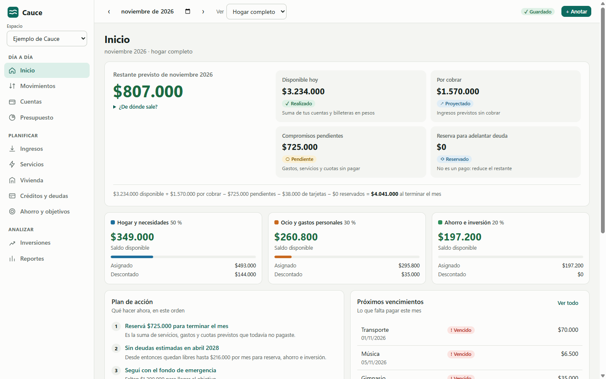
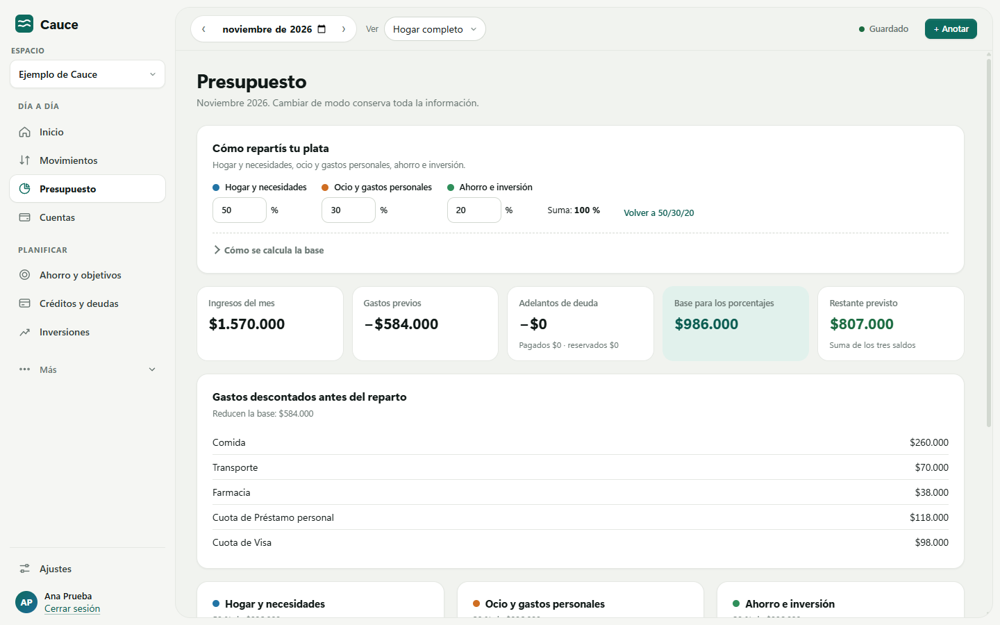
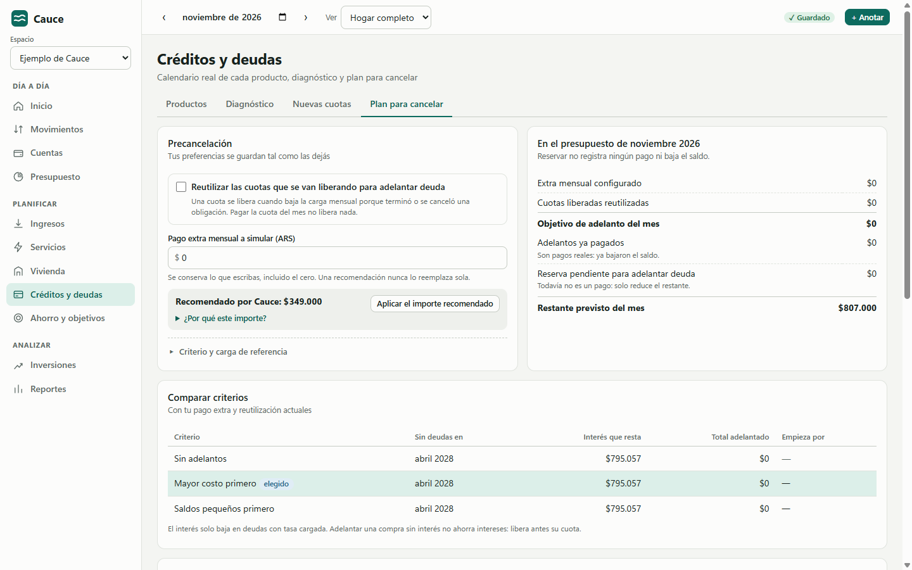
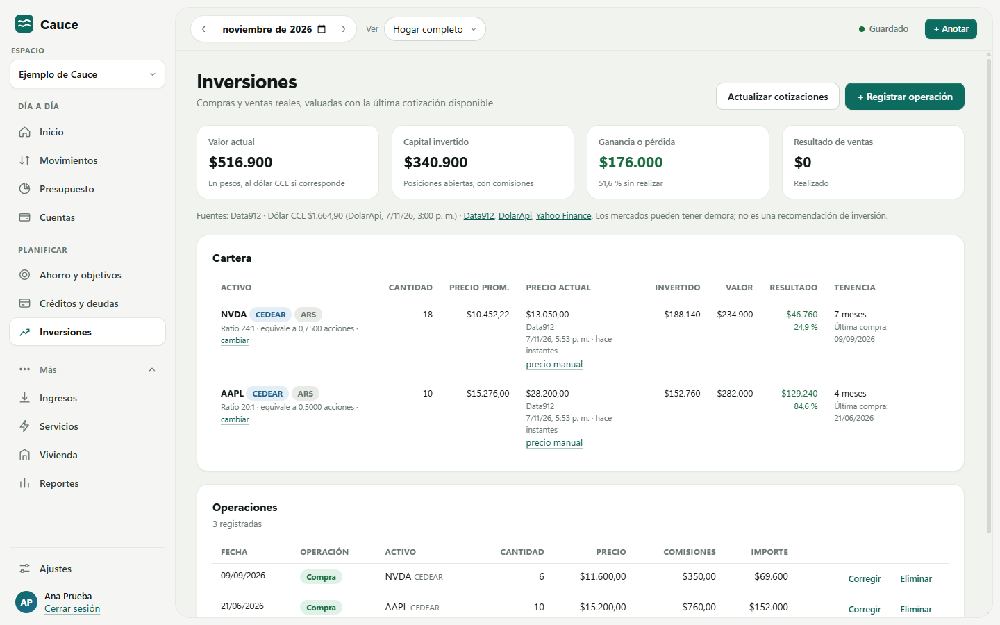
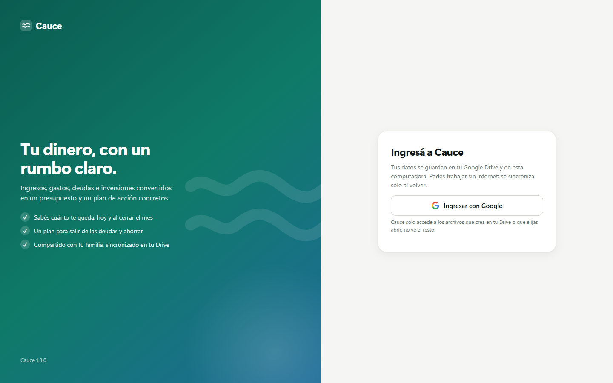

  

<h1 align="center">Cauce</h1>

  <strong>Tu dinero, con un rumbo claro.</strong> 
  Finanzas personales y del hogar para Windows: presupuesto, deudas, inversiones y objetivos, en pesos argentinos.

  
  
  
  

  <a href="https://github.com/th-arroyo/cauce-releases/releases/latest"><strong>Descargar para Windows</strong></a>
  ·
  <a href="#instalación">Cómo instalar</a>
  ·
  <a href="#tus-datos">Privacidad</a>

  <picture>
    <source media="(prefers-color-scheme: dark)" srcset="assets/inicio-oscuro.png">
    
  </picture>

## Qué hace

Cauce convierte tus ingresos, gastos, deudas e inversiones en un presupuesto y un plan de acción concretos. Sirve para una persona, una pareja o una familia.

| Función | Qué te permite |
|---|---|
| **Presupuesto 50/30/20** | Porcentajes configurables y dos modos de cálculo. Cada total se puede abrir para ver de dónde sale. |
| **Ingresos y gastos** | Lo previsto y lo realizado en una sola obligación: pagar un servicio o cobrar un sueldo nunca cuenta dos veces. |
| **Créditos y tarjetas** | Calendario real de cada préstamo y compra en cuotas, diagnóstico de endeudamiento y capacidad para nuevas cuotas. |
| **Precancelación** | Plan mes a mes para adelantar deuda, con extra mensual y reutilización de cuotas que se liberan. |
| **Vivienda y mudanza** | Vivir con familiares, alquilar solo o en pareja, y escenarios de mudanza sin tocar tus datos reales. |
| **Inversiones** | CEDEARs y acciones con cotizaciones actualizadas, precio promedio, resultado y tiempo de tenencia. |
| **Ahorro y objetivos** | Fondo de emergencia y metas, con recomendaciones que respetan tu presupuesto. |
| **En pareja o en familia** | Compartí un espacio con permiso de lectura o de edición, y revocalo cuando quieras. |

## Capturas

<table>
  <tr>
    <td width="50%">
      <picture>
        <source media="(prefers-color-scheme: dark)" srcset="assets/presupuesto-oscuro.png">
        
      </picture>
      
<b>Presupuesto</b>: base, asignación, descuentos y saldo de cada categoría.

    </td>
    <td width="50%">
      <picture>
        <source media="(prefers-color-scheme: dark)" srcset="assets/deudas-oscuro.png">
        
      </picture>
      
<b>Precancelación</b>: cuánto adelantar, a qué producto y cuándo terminás.

    </td>
  </tr>
  <tr>
    <td width="50%">
      <picture>
        <source media="(prefers-color-scheme: dark)" srcset="assets/inversiones-oscuro.png">
        
      </picture>
      
<b>Inversiones</b>: cotización, fuente, resultado y tenencia.

    </td>
    <td width="50%">
      <picture>
        <source media="(prefers-color-scheme: dark)" srcset="assets/ingreso-oscuro.png">
        
      </picture>
      
<b>Ingreso</b>: con tu cuenta de Google, sin contraseñas nuevas.

    </td>
  </tr>
</table>

Las capturas usan datos de ejemplo.

## Instalación

1. Descargá **`Cauce-Setup-<versión>.exe`** desde la [última versión](https://github.com/th-arroyo/cauce-releases/releases/latest).
2. Abrilo. Si Windows muestra **«Windows protegió tu PC»**, tocá **Más información** y después **Ejecutar de todos modos**. Aparece porque el instalador no tiene una firma comercial.
3. Cauce se instala solo para tu usuario, sin pedir permisos de administrador, y crea accesos directos en el escritorio y en el menú Inicio.
4. Tocá **Ingresar con Google**.

**Requisitos:** Windows 10 u 11 de 64 bits y una cuenta de Google. Hace falta internet para el primer ingreso; después la app funciona también sin conexión.

## Actualizaciones

Cada vez que abrís Cauce, la app busca una versión nueva. Si la hay, te muestra las novedades y **te pregunta antes de descargar e instalar**. Si elegís «Más tarde», seguís usando tu versión y vuelve a preguntar la próxima vez. Tus datos no se modifican al actualizar.

## Tus datos

- **En tu Google Drive.** Cada espacio es un archivo dentro de la carpeta «Cauce» de tu Drive, con una copia en tu computadora para usar la app sin internet.
- **Acceso mínimo.** Cauce solo puede abrir los archivos que crea o que elegís; no ve el resto de tu Drive.
- **Sin servidores propios.** No hay una base de datos de Cauce: nadie más recibe tu información.
- **Sin publicidad ni seguimiento.** La app no tiene publicidad ni herramientas de análisis, y no vende datos.
- **Cotizaciones.** Para actualizar precios solo se consultan los símbolos de tus inversiones, como «NVDA», a Data912, DolarApi y Yahoo Finance.

Para borrar todo: eliminá la carpeta «Cauce» de tu Drive, cerrá sesión en la app, borrá `%APPDATA%\Cauce` y quitá el permiso en [tu cuenta de Google](https://myaccount.google.com/permissions).

## Preguntas frecuentes

<b>¿Puedo usar Cauce sin internet?</b>

 
Sí. Todo se guarda primero en tu computadora y se sincroniza con Drive cuando vuelve la conexión. Si mientras tanto alguien cambió el mismo espacio, Cauce te pregunta qué versión conservar: nunca pisa datos en silencio.

<b>¿Cómo comparto mis finanzas con mi pareja?</b>

 
En <b>Ajustes › Acceso</b>, escribí su correo y elegí si puede solo leer o también editar. La otra persona abre el espacio desde <b>Elegir en Google Drive</b>. Podés cambiar o quitar el permiso en cualquier momento.

<b>¿Por qué Google me pide volver a ingresar cada tanto?</b>

 
Mientras la app esté en etapa de prueba en Google, la sesión dura 7 días. Volvés a tocar «Ingresar con Google» y seguís donde estabas; no se pierde nada.

<b>¿Cómo desinstalo Cauce?</b>

 
Desde <b>Configuración de Windows › Aplicaciones</b>. Tus datos quedan en Drive y en <code>%APPDATA%\Cauce</code> hasta que decidas borrarlos.

---

Cauce es una herramienta de organización personal. No brinda asesoramiento financiero, impositivo ni de inversión. Las cotizaciones provienen de servicios de terceros y pueden tener demoras.
